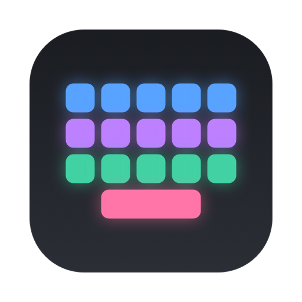
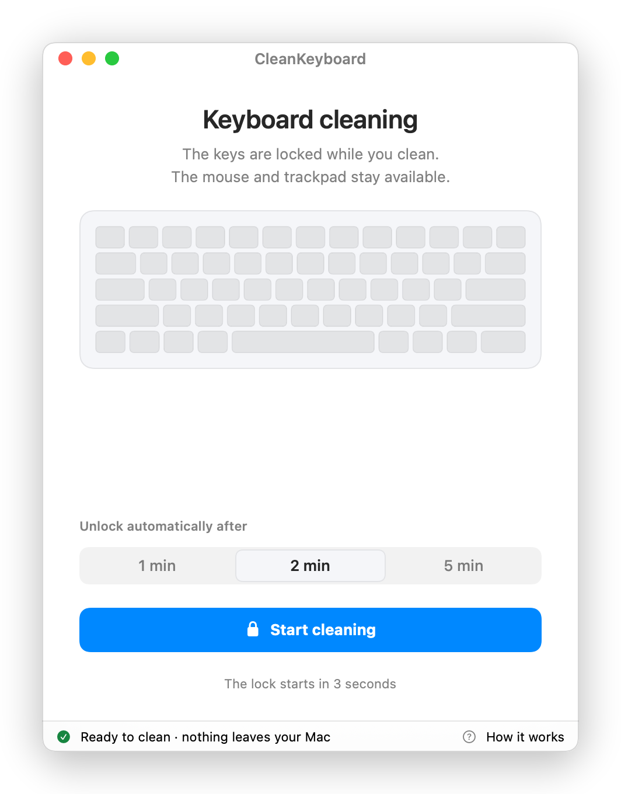
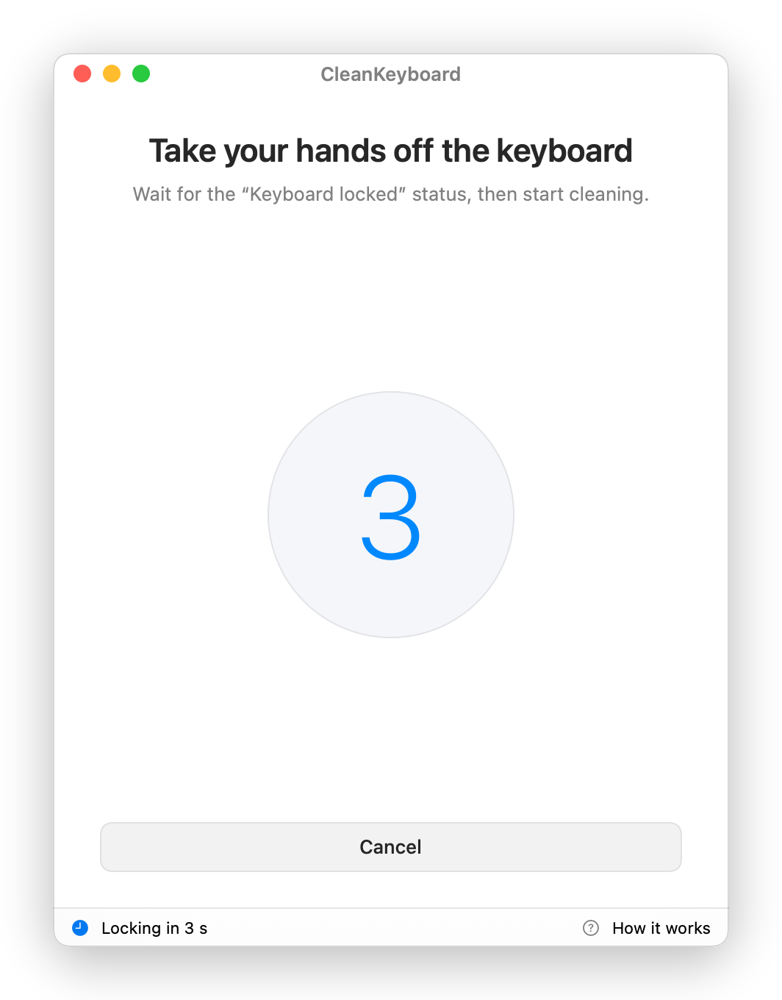
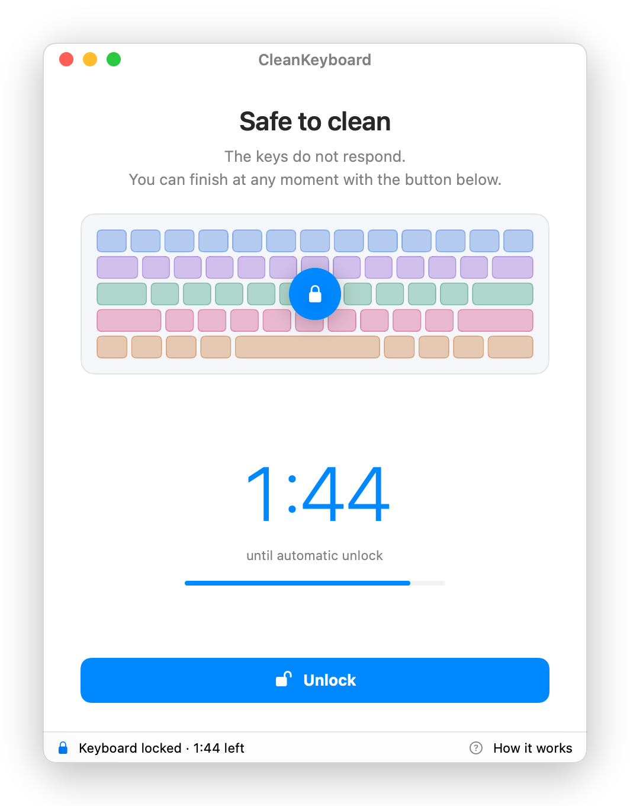
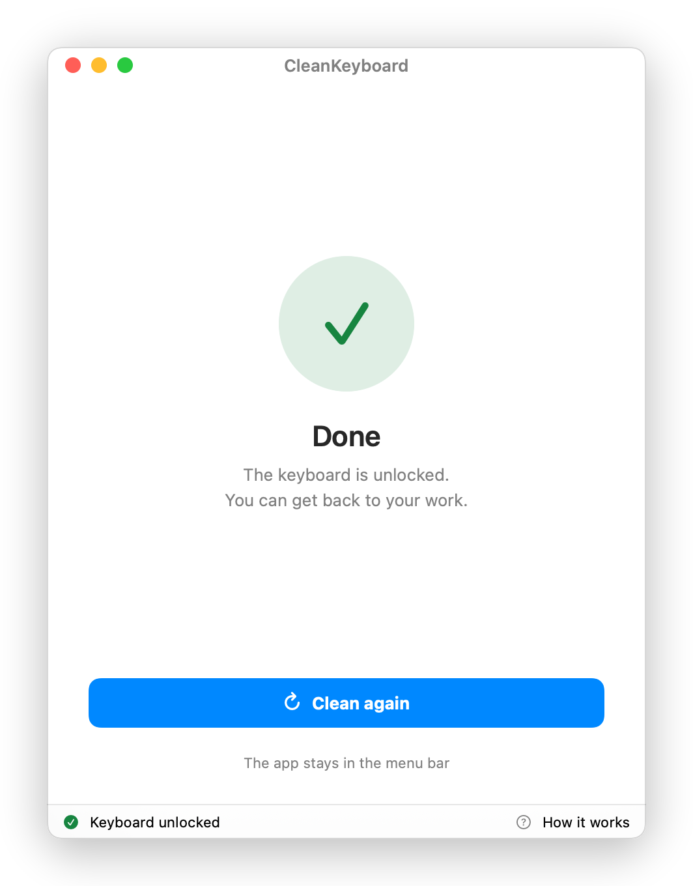

<p align="center">
  
</p>

<h1 align="center">CleanKeyboard</h1>

<p align="center">
  <strong>Lock your Mac's keyboard while you clean it</strong><br>
  The mouse and trackpad keep working. Native, no dependencies, no network.
</p>

<p align="center">
  <a href="https://github.com/mihranapozyan/CleanKeyboard/releases/latest">
    
  </a>
</p>

<p align="center">macOS 14 or later · Apple Silicon and Intel</p>

<p align="center">
  <picture>
    <source media="(prefers-color-scheme: dark)" srcset="docs/screenshots/ready-dark.png">
    
  </picture>
</p>

<table>
  <tr>
    <td align="center">
      <picture>
        <source media="(prefers-color-scheme: dark)" srcset="docs/screenshots/countdown-dark.png">
        
      </picture>
    </td>
    <td align="center">
      <picture>
        <source media="(prefers-color-scheme: dark)" srcset="docs/screenshots/cleaning-dark.png">
        
      </picture>
    </td>
    <td align="center">
      <picture>
        <source media="(prefers-color-scheme: dark)" srcset="docs/screenshots/completed-dark.png">
        
      </picture>
    </td>
  </tr>
</table>

## Download

Click **Download for Mac** above, or open the [Releases](https://github.com/mihranapozyan/CleanKeyboard/releases/latest) page. Download `CleanKeyboard-<version>.zip`, unzip it and move `CleanKeyboard.app` to Applications. A checksum (`.sha256`) is attached next to the archive.

The app is signed locally, without a Developer ID, so on first launch macOS may say it cannot verify the developer. Right-click the app → Open → Open. Or remove the quarantine flag in Terminal:

```sh
xattr -dr com.apple.quarantine /Applications/CleanKeyboard.app
```

## Getting started

1. Move `CleanKeyboard.app` to `/Applications` so the app path stays constant.
2. Open the app and click **Allow in macOS**.
3. In the Privacy settings pane that opens, turn on CleanKeyboard. Add the app with the "+" button if it is not listed. Depending on the macOS version, this pane may be named Accessibility or something similar.
4. Return to the app. The permission is detected automatically. If macOS asks you to restart the app, restart it.
5. Pick 1, 2 or 5 minutes and click **Start cleaning**. Take your hands off the keyboard and wait for the three-second countdown to end and the "Keyboard locked" status.
6. Unlock with the mouse using **Unlock**, or wait for the timer.

Closing the window during a session also unlocks the keyboard. The app stays in the menu bar; from there you can open the window, start a session, unlock the keyboard and quit.

## Features

- Native look: system colours and materials, automatic light and dark appearance, the macOS accent colour, a status bar at the bottom, large buttons and a countdown.
- Regular keys, modifiers and the media key events available to the app are filtered, and only during a session.
- All connected keyboards are locked together.
- Keys that are held down when the countdown ends postpone the lock until they are released.
- Command, Shift, Control, Option and Fn do not change what the mouse does while you clean.
- The timer uses a monotonic clock, so changing the system time does not affect it.
- The session ends automatically on sleep, display sleep, user switch, screen lock, permission revoked, and when macOS disables the filter.
- While a session runs, the window with the unlock button stays above regular windows. The minimise button is disabled.
- Keystrokes are never stored, analysed or sent anywhere.

The power button and Touch ID are not blocked. This is a cleaning utility, not a system lock or a security mode. It is not meant for the login screen or secure password entry; the session ends if secure input is detected. Whether special hardware keys can be blocked depends on whether macOS delivers them to the app.

## Building

Open `CleanKeyboard.xcodeproj` in Xcode and choose the CleanKeyboard → My Mac scheme. Or run this in the project folder:

```sh
./Scripts/build.sh
```

The finished `.app` appears in the project root. The build is universal: Apple Silicon and Intel. Signing is local (ad hoc, Sign to Run Locally), with no Developer Account and no provisioning profile that expires after 7 days. A paid Apple Developer membership is not needed to run it on your own Mac. To distribute it comfortably to other people, set up a Developer ID and notarisation.

After a rebuild, macOS may ask you to grant the input-control permission again. This is a property of local signing.

## Checks

```sh
./Scripts/test.sh
```

The checks cover the filtering rules and the event handler (keys are suppressed, mouse and scrolling pass through, mouse modifiers are cleared), and the whole session state machine running against fake services and a fake clock: permissions, countdown, waiting for held keys, the timer, interruptions (sleep, screen lock, revoked permission, filter disabled by macOS), manual unlock and persisting the chosen duration. No real keyboard filter is installed.

Manual checks on a Mac after granting the permission:

- Cancelling during the countdown leaves input available.
- Once the lock status shows, letters and shortcuts do not reach other apps; the mouse works.
- Unlocking with the mouse works even while Control or Command is held.
- The timer unlocks the keyboard automatically.
- Closing the window, quitting, sleep and screen lock all unlock the keyboard.
- Revoking the permission or turning on secure input never leaves a false locked status.

To check the layout without locking anything: `open CleanKeyboard.app --args --preview` and `open CleanKeyboard.app --args --preview-cleaning` (quit the app between launches). These modes show the interface and never capture input.

## Structure

MVVM: views know nothing about the system, the view model knows nothing about the interface, and every call into macOS sits behind a protocol.

- `App`: entry point, `AppDelegate` (composition root), window, menu bar item, main menu.
- `Models`: session phase, interruption reasons, pure rules (`SessionPolicy`).
- `Services`: permission and system state, keyboard filter, sleep and lock events. Each has a protocol and a fake for the checks and for `--preview`.
- `ViewModels`: `CleanSessionViewModel` (`@Observable`): the session state machine and timers, with dependencies injected through the initialiser.
- `Views`: phase screens and components. `Support`: theme.
- `Assets.xcassets`: app icon. `Tests`: behaviour checks that never lock a real keyboard. `Scripts`: build, checks, release packaging, icon generator. `docs`: README images.

## Releasing

1. Bump `CFBundleShortVersionString` in `CleanKeyboard/Info.plist`.
2. Run `./Scripts/package.sh`. It builds the app and creates `dist/CleanKeyboard-<version>.zip` and a checksum file.
3. On the repository page open Releases → Draft a new release, create the tag `v<version>`, attach both files from `dist` and publish.
